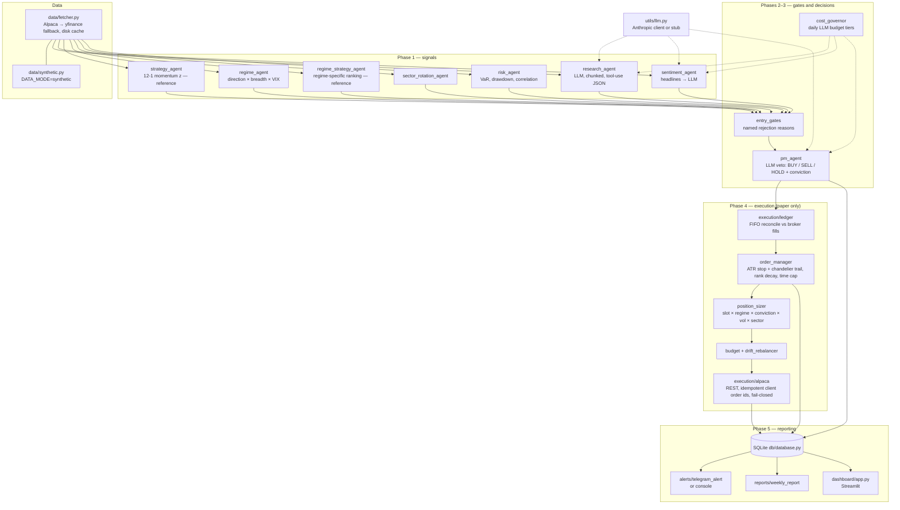

# AI Hedge Fund

A daily, multi-agent equity pipeline. Quantitative signals, LLM research and sentiment, and an LLM portfolio-manager veto feed rule-based sizing, risk gates, an ATR exit engine and a paper-trading broker client. Every decision is logged to SQLite and reported.

> **SHOWCASE VERSION** — This public repository is a sanitized demonstration of a private project. Proprietary logic, parameters, and licensed data have been removed or replaced with synthetic data. The full private repository can be reviewed on request: read-only collaborator access can be granted during an interview.

> **Offline by default for the demo.** With `DATA_MODE=synthetic`, `LLM_MODE=stub` and `ALERTS_MODE=console`, the full pipeline runs with no network, API keys or broker:
> - Prices, fundamentals and headlines come from a seeded generator (`data/synthetic.py`).
> - LLM calls are answered by a deterministic schema-driven stub (`utils/llm.py`).
> - Outputs in this mode carry **no analytical meaning**.

---

## Problem and motivation

Combining systematic signals with LLM judgement is easy to prototype and hard to run reliably every day. Data feeds fail, LLM responses get truncated, budgets run out, and broker state drifts from local state. This project is the operational side of that problem:

- One pipeline with explicit phases and fail-closed defaults.
- Cost-governed LLM calls.
- A single exit engine.
- A ledger that reconciles against broker fills.
- Health checks that catch "ran fine but did nothing" days.

## Architecture



Entry points:

| File | Role |
|---|---|
| `main.py` | One full run: signals → gates → decisions → alert → exits/entries (paper only) → reports. `--dry-run` submits nothing. A run lock prevents overlap. |
| `scheduler.py` | Weekday schedule in ET (morning run, optional midday run, Friday weekly report). |
| `chat.py` + `chat/` | Terminal assistant. An LLM routes the question; trade proposals pass the same pre-trade gates before a confirmed paper execution. |
| `health_check.py` | Checks the API key, broker reachability (paper), scheduler and last run. |
| `backtest/reference_backtest.py` | Daily event-driven backtest that reuses the live sizing, regime, ATR and trailing-stop code. |
| `dashboard/app.py` | Streamlit view over the run logs. |

## Tech stack

Python 3.12+, pandas and NumPy, the Anthropic Python SDK (tool use with strict JSON schemas, streaming), SQLite (WAL), `requests` against the Alpaca REST API (no SDK), Streamlit and Plotly, pytest, and ruff.

## Key features

- **Strict structured LLM output.** Research, sentiment and the PM each force a tool call with a strict JSON schema:
  - Truncated responses (`stop_reason=max_tokens`) are detected and retried with more headroom.
  - Research runs in parallel chunks, so one bad response only degrades its own tickers.
- **LLM cost governor.** Before every call, the worst-case cost is estimated against a daily budget. Calls degrade through FULL → REDUCED → MINIMAL → BLOCKED tiers, and usage is recorded per call.
- **Fail-closed defaults:**
  - The run aborts when too much of the universe has no data.
  - Broker access requires `PAPER_TRADING=true`; there is no live-trading code path.
  - Unknown open-order state blocks writes.
- **Single exit engine.** Initial ATR stop, a chandelier trail that only rises, rank-decay exit, PM SELL exit and a maximum holding period. One broker-side stop per position is audited every run.
- **Ledger.** Broker fills are reconciled into a FIFO trades table, so exits the broker executed on its own are recorded.
- **Idempotent orders.** Deterministic client order ids, with duplicate-id reconciliation on retries.
- **Decision funnel and health alerts.** Every discarded candidate gets a reason code. Silent failures, such as "BUY signals but zero orders", raise an alert.
- **Test suite.** About 650 offline tests. Network, Telegram and broker access are blocked at the fixture level (`tests/conftest.py`).

## Run the demo (offline)

```bash
python -m venv .venv && source .venv/bin/activate
pip install -r requirements.txt

# 1. Full pipeline, dry run, synthetic data, stub LLM, alerts to the console
DATA_MODE=synthetic LLM_MODE=stub ALERTS_MODE=console python main.py --dry-run

# 2. Reference backtest on synthetic data
DATA_MODE=synthetic python -m backtest.reference_backtest --start 2022-01-01 --end 2025-12-31

# 3. Tests and lint
pip install pytest ruff
pytest -q
ruff check .
```

In the dry run without a broker (`PAPER_TRADING` unset), the execution phase is skipped. The health check then reports that BUY signals produced no orders; that alert is the expected output in this mode. Some console labels are in Spanish, the project's working language.

Live services (optional): copy `.env.example` to `.env` and set the Anthropic key, an Alpaca **paper** key and a Telegram bot. The dashboard (`streamlit run dashboard/app.py`) and `chat.py` need live services: price overlays and the LLM router respectively.

## Screenshots

> Placeholders. No images are included yet.

| # | What to capture | Suggested file |
|---|---|---|
| 1 | Terminal output of the synthetic dry run: the "Research Snapshot" table and the console `[ALERT]` | `docs/img/dry-run.png` |
| 2 | Reference-backtest console summary (label "SYNTHETIC DATA") | `docs/img/backtest.png` |
| 3 | Streamlit dashboard pointed at the demo `logs/` folder | `docs/img/dashboard.png` |
| 4 | `pytest -q` summary line | `docs/img/tests.png` |

## Project structure

```
ai-hedge-fund/
├── main.py                 # pipeline entry point (--dry-run)
├── scheduler.py            # weekday schedule (ET)
├── chat.py, chat/          # terminal assistant: router, context, proposal, pre-trade gates, executor
├── health_check.py
├── config.py               # all parameters (SHOWCASE: placeholders)
├── agents/                 # research, sentiment, strategy*, regime, regime_strategy*, pm, entry_gates,
│                           # position_sizer, sector_rotation, risk, risk_sl_tp, rotation, budget,
│                           # cost_governor, llm_usage            (* = reference implementation)
├── data/                   # fetcher (Alpaca → yfinance), alpaca_data, synthetic
├── execution/              # alpaca (paper-only REST), trade_executor, order_manager, ledger, drift_rebalancer
├── alerts/                 # Telegram sender (token-redacting) / console mode
├── backtest/               # reference_backtest.py
├── db/                     # SQLite schema and access
├── reports/                # weekly report, conviction backfill
├── dashboard/              # Streamlit app
├── utils/                  # env loader, retry, funnel, llm client factory/stub
└── tests/                  # offline pytest suite
```

## Limitations

- **Placeholder parameters.** Every value in `config.py` marked `SHOWCASE: placeholder` is a neutral default. Results produced with them say nothing about the private strategy.
- **Reference signals.** `strategy_agent` and `regime_strategy_agent` are textbook 12-1 momentum rankers. The private signal models are not included.
- **Synthetic data** is random-walk based. **Stub LLM** output is deterministic filler that only exercises the schema plumbing.
- **Reference backtest** uses daily bars, a flat cost per side, no borrow costs and no corporate actions.
- **The dashboard** fetches live prices for its overlays and is not part of the offline demo.

## Roadmap

- Point-in-time fundamentals for the value leg of the backtest.
- Walk-forward evaluation harness in the public version (private version: see interview).
- Typed settings (pydantic) instead of module-level constants.
- Containerised scheduler with structured logs.

## What this showcase omits and why

| Omitted / changed | Why |
|---|---|
| Tuned parameters (`config.py`), the curated universe | Proprietary. Replaced with labelled placeholders and a 22-name illustrative universe. |
| Composite signal, macro filter, regime-specific selection models | Proprietary alpha logic. Replaced with a reference 12-1 momentum implementation behind the same interfaces. |
| Research layer (factor/IC studies, walk-forward, parameter sweeps, strategy comparisons) and their tests | Contains research results and strategy development history. Replaced by `backtest/reference_backtest.py`. |
| Tests that pinned private parameter values or covered replaced logic (95), plus the research-layer tests (114) | They encoded the proprietary numbers or tested code that is not published. 14 new tests cover the reference code, synthetic data, the stub LLM, token redaction and the paper-only guard. The original private suite had 846 tests. |
| PM prompt specifics, design docs, specs, plans, performance tables | Proprietary or internal. Prompts were reduced to generic wording. |
| Market data caches, logs, database, account snapshots, order ids | Third-party data with redistribution limits, and private account information. |
| Git history | Fresh history for the showcase. |

Also changed for safety: broker access fails closed without `PAPER_TRADING=true`, the Telegram sender redacts the bot token from transport errors, and alerts can be printed to the console.

## License

All rights reserved. See [LICENSE](LICENSE).
